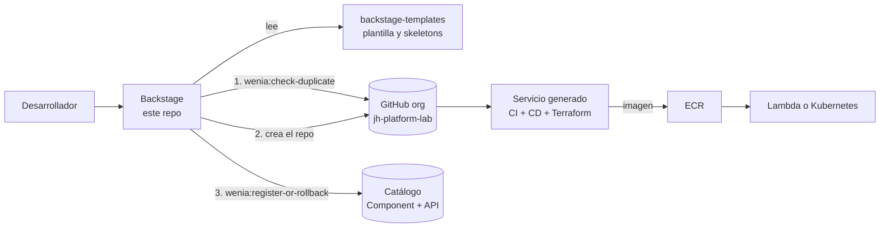

# wenia-platform

Portal interno de autoservicio sobre **Backstage**: desde un formulario genera un microservicio (Python o Node.js, como AWS Lambda o servicio de Kubernetes) con repositorio, catálogo, Dockerfile, CI/CD, Terraform, observabilidad y documentación operativa.

Caso técnico "Platform Engineer". Este repo contiene el portal, sus acciones propias y la infraestructura base. Las plantillas viven en otro repo para que evolucionen por separado.

## Cómo encaja



| Repo | Qué contiene |
|---|---|
| [`wenia-platform`](https://github.com/jh-platform-lab/wenia-platform) | Backstage, acciones propias del scaffolder, Ansible, `verify.sh`, evidencia |
| [`backstage-templates`](https://github.com/jh-platform-lab/backstage-templates) | Plantilla `python-service`: `skeleton-common`, `skeleton-python`, `skeleton-nodejs` |
| [`onboarding-api`](https://github.com/jh-platform-lab/onboarding-api) | Servicio de ejemplo generado con la plantilla, con 6 endpoints reales |

## Arrancar en local

Requisitos: Docker, Node 24 (`.nvmrc`) y un token de GitHub de la organización (ver `.env.local.example`).

```bash
cp .env.local.example .env.local        # completa POSTGRES_PASSWORD y GITHUB_TOKEN (no se sube a git)
```

| Forma | Comandos | Cuándo |
|---|---|---|
| Desarrollo (recarga en segundos) | `docker compose up -d postgres` y luego `cd backstage && yarn install && yarn start` | Cambiar código de Backstage |
| Todo en contenedores | `bash scripts/build-backstage-image.sh` y `docker compose --profile app up -d` | Demostración; simula el despliegue en Kubernetes |

Abre http://localhost:3100, entra como invitado y ve a **Create**. Puertos propios del reto: web 3100, backend 7100, Postgres 5442.

`ansible-playbook -i ansible/inventory.ini ansible/prepare-env.yml` prepara los archivos locales y es idempotente: la segunda ejecución termina con `changed=0`.

## Qué hace el formulario

Valida antes de crear nada y cubre los cuatro casos del reto:

| Caso | Qué pasa |
|---|---|
| Solicitud válida | Crea el repo, lo registra en el catálogo y devuelve los enlaces |
| Solicitud inválida | El formulario rechaza el nombre (formato DNS, 3–40 caracteres) y no ejecuta ningún paso |
| Nombre duplicado | `wenia:check-duplicate` consulta el catálogo y GitHub; la tarea falla en el primer paso y no crea nada |
| Fallo durante la generación | Si el registro falla tras crear el repo, `wenia:register-or-rollback` borra el repo de esa tarea y deja la tarea fallida |

El rollback solo borra repos de la organización permitida, con nombre válido y creados hace menos de 15 minutos.

## Verificar

```bash
bash scripts/verify.sh --kind     # ~10 min; todo corre en contenedores
```

Ejecuta las pruebas de la API, renderiza la plantilla en Python y Node.js, corre sus pruebas, valida Terraform (`fmt`, `validate`, `checkov`), construye las imágenes, repite Ansible y despliega en Kind. Lo que requiere AWS o una persona se lista aparte sin ejecutarse. El mapa de requisitos y evidencias está en [`evidence/README.md`](evidence/README.md).

## Operar y diagnosticar

**Observabilidad del proceso de generación.** Las acciones escriben una línea JSON por evento (`ts`, `level`, `action`, `requestId`, `service`, `event`). El `requestId` es el id de la tarea del scaffolder: sirve para seguir una solicitud en la página de la tarea, en `GET /api/scaffolder/v2/tasks/<requestId>` o con `grep` en el log del backend.

| Síntoma | Causa probable | Qué hacer |
|---|---|---|
| Pantalla en blanco, 401 en el catálogo (contenedor) | El login de invitado está bloqueado con `NODE_ENV=production` | La config del contenedor ya lo autoriza (`app-config.k8s.yaml`); reconstruye la imagen |
| `docker compose pull` dice `access denied` | Usa el nombre de la imagen local | Define `BACKSTAGE_IMAGE=ghcr.io/jh-platform-lab/backstage:latest` o construye la local |
| La tarea falla en "Verificar que el nombre no exista" | El servicio ya existe en el catálogo o en GitHub (evento `duplicate`) | Usa otro nombre |
| La tarea falla al registrar y no queda repo | Rollback ejecutado (evento `rollback`) | Revisa la causa en el log y reintenta |
| La plantilla no aparece en Create | El catálogo aún no leyó GitHub | Espera unos segundos; en el contenedor la plantilla se lee de `main` |
| `kubectl` apunta a otro cluster | El contexto activo no es el de Kind | Los scripts usan siempre `--context kind-...` |

El troubleshooting de cada servicio generado vive en el `README.md` que la plantilla le entrega.

## Evolución de las plantillas

Cada servicio nace con la anotación `wenia.io/template-version` en su `catalog-info.yaml`. Cuando la plantilla sube de versión (ver `CHANGELOG.md` de `backstage-templates`), esa anotación permite saber qué servicios quedaron atrás. Cada cambio de plantilla va por pull request y sube la versión.

## Estructura

```
backstage/            app de Backstage y acciones propias (packages/backend/src/modules/wenia-actions)
catalog/org.yaml      equipos (Group) que valida el campo "owner" del formulario
ansible/              preparación idempotente del entorno local
infra/modules/        módulos Terraform base (bucket de estado)
scripts/              verify.sh, render-skeleton.js, build-backstage-image.sh, login y comprobación del entorno
evidence/             evidencia local y de AWS, con su índice
docs/uso-ia.md        cómo se usó la IA en este trabajo
```

## Límites actuales

- El despliegue a AWS (ECR, OIDC, Lambda) está escrito y validado de forma estática, pero su `apply` se hace en una sesión aparte; hasta entonces no se da por probado.
- El despliegue a EKS es un marcador en el CD. El tipo Kubernetes se probó en Kind.
- New Relic está configurado (agente, alertas y dashboard como código) y no verificado con una cuenta real.
- La imagen de Backstage que publica el CI es `amd64`.
