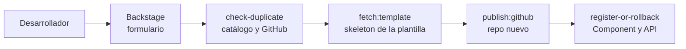

# Plataforma de autoservicio para microservicios

Caso "Platform Engineer" de Wenia. Repositorios en la organización `jh-platform-lab`: `wenia-platform` (portal), `backstage-templates` (plantillas) y `onboarding-api` (servicio de ejemplo).

## 1. Resumen

Un desarrollador llena un formulario en Backstage (nombre, lenguaje, equipo, descripción, APIs y tipo) y obtiene en minutos un repositorio de GitHub con el código del servicio, un Dockerfile por tipo de despliegue, CI y CD separados, Terraform, observabilidad de New Relic como código, documentación operativa y registro en el catálogo.

**Estado.** Funciona de extremo a extremo en local para Python y Node.js, y se verifica con `scripts/verify.sh` (11 comprobaciones en verde). El flujo completo hasta AWS está probado para Python: un servicio creado desde Backstage se despliega como Lambda con Terraform y responde en su Function URL (sección 6).

## 2. Arquitectura

Cada plantilla es una carpeta con su `template.yaml` y su `skeleton/`. Backstage muestra una card por plantilla. Si el registro falla después de crear el repo, la misma acción lo borra y la tarea queda fallida.

## 3. Decisiones

| Decisión | Motivo |
|---|---|
| Validar el formulario antes de ejecutar | Una solicitud inválida no crea nada |
| Verificar duplicados en catálogo **y** GitHub | Con solo el catálogo quedaría un repo huérfano sin detectar |
| Rollback dentro de una sola acción | Los pasos del scaffolder no tienen "en caso de fallo" |
| Una carpeta autocontenida por plantilla | Con `file:` el scaffolder solo lee dentro de la carpeta, así que lo compartido no funciona en local |
| CI separado de CD; CD con entorno `production` | El CI valida sin publicar; solo el CD toca la nube |
| OIDC en lugar de llaves | El rol de CD solo acepta el entorno `production` del repo; el `plan` de los PR usa otro rol de solo lectura |
| Terraform con módulos locales y estado remoto por servicio | Cada servicio se puede reintentar o destruir sin tocar a los demás |
| Lambda como imagen de contenedor | ECR existe antes que la función (primer `apply` acotado con `-target`); Terraform ignora la imagen para no revertir el CD |
| New Relic según el tipo | APM en Kubernetes; CloudWatch en Lambda |

## 4. Verificación

| Caso | Resultado | Evidencia |
|---|---|---|
| Creación válida (Python, Lambda) | Repo, catálogo y API creados; CI en verde | `evidence/local/01-*` |
| Solicitud inválida | Rechazada por el formulario | `evidence/local/02-*` |
| Nombre duplicado | Falla en el primer paso | `evidence/local/03-*` |
| Fallo con rollback | Tarea fallida, repo borrado | `evidence/local/04-*` |
| Servicio Node.js generado | Pruebas, Trivy y `/health` correctos | Repo `demo-node-2` |
| API de ejemplo (6 endpoints) | 11 pruebas en verde | `evidence/local/05-*` |
| Terraform (fmt, validate, checkov) | Sin fallos | `evidence/local/08-verify.txt` |
| Ansible, segunda ejecución | `changed=0` | `evidence/local/06-*` |
| Kubernetes en Kind | 2 réplicas; `/health` responde | `evidence/local/07-*` |
| **AWS:** CD crea ECR, rol y Lambda | `demo-final4`: CD en verde, imagen con el SHA del commit | `evidence/aws/10-*`, `11-*` |
| **AWS:** Function URL | `/health` responde 200 | `evidence/aws/15-*` |
| New Relic con cuenta real | Agente conectado y datos de throughput y latencia | `evidence/local/09-*` |

`verify.sh` separa lo ejecutado de lo que requiere AWS o una persona y no presenta una validación estática como despliegue.

## 5. Qué medir

**Del proceso de generación** (cada evento es una línea JSON con `requestId`):

| Métrica | Por qué |
|---|---|
| Tasa de éxito de las tareas y causa de cada fallo | Mide la fiabilidad del portal |
| Duración de la tarea (p50 y p95) | Es la promesa de "en minutos" |
| Rollbacks fallidos | Dejan un repo huérfano; deben ser cero |

**De la plataforma:** tiempo hasta el primer despliegue de un servicio nuevo, servicios por plantilla y versión (desactualizados), tasa de CI en verde y costo de AWS por servicio.

## 6. Despliegue en AWS

Cuenta dedicada y presupuesto de 5 USD; se evita lo que cuesta sin necesidad (ALB, RDS, Secrets Manager). Un **bootstrap** manual crea una vez el estado de Terraform (S3 con KMS), el proveedor OIDC, la alerta de presupuesto y dos roles (CD y `plan`). Después, cada servicio se despliega solo desde su CD: `apply` de ECR y rol, imagen publicada con el SHA, `apply` de la Lambda y `update-function-code`.

Llegar al primer despliegue exitoso costó varias iteraciones, cada una con una causa distinta que quedó corregida en el código o en la plantilla (versión 1.6.6): el subject OIDC inmutable de la organización, los permisos de lectura que el proveedor de Terraform necesita al refrescar, un `apply` sin `-target` que destruía la Lambda al reintentar, una imagen con atestaciones que Lambda rechaza y la falta de una política de ECR para que Lambda lea la imagen.

**Pendiente:** destruir los servicios de prueba al terminar, y migrar Node.js, Go y Java al mismo CD.

## 7. Evolución de las plantillas

Cada servicio guarda la anotación `wenia.io/template-version`. Hoy existen nueve plantillas: Python, Node.js, Go y Java; S3 y SQS; y tres de gestión (`update-service`, `add-observability` y `team-registration`). La versión de cada cambio está en el `CHANGELOG`.

**Pendiente:** un proceso programado que detecte servicios desactualizados, y un workflow que renderice y pruebe cada plantilla antes de fusionar.

## 8. Límites

- Solo Python tiene el CD de AWS probado. El tipo Kubernetes se probó en Kind, sin EKS ni ArgoCD. El `apply` del bootstrap es manual.
- New Relic: el agente de Node reporta a una cuenta real desde Kind (`evidence/local/09-*`). Las alertas y el dashboard están como código, pero no se aplicaron con Terraform (requieren una API key de usuario).
- Go, Java, S3, SQS y las plantillas de gestión: validadas por partes, sin prueba completa desde la interfaz.

**Procedencia.** Backstage (distribución estándar, con la configuración de Wenia), mkdocs-material y mkdocs-techdocs-core (TechDocs), Express y serverless-http (Node.js), FastAPI y Mangum (Python), net/http (Go), Spring Boot (Java), imágenes base oficiales (`node:24-slim`, `python:3.12`, `public.ecr.aws/lambda`, `distroless`) y las acciones oficiales de GitHub. No se usó código de empleadores.

**Uso de IA.** El trabajo se hizo con Claude Code bajo dirección y revisión de una persona; cada cambio pasó por un PR fusionado por ella. Detalle y errores de la IA en `docs/uso-ia.md`.
