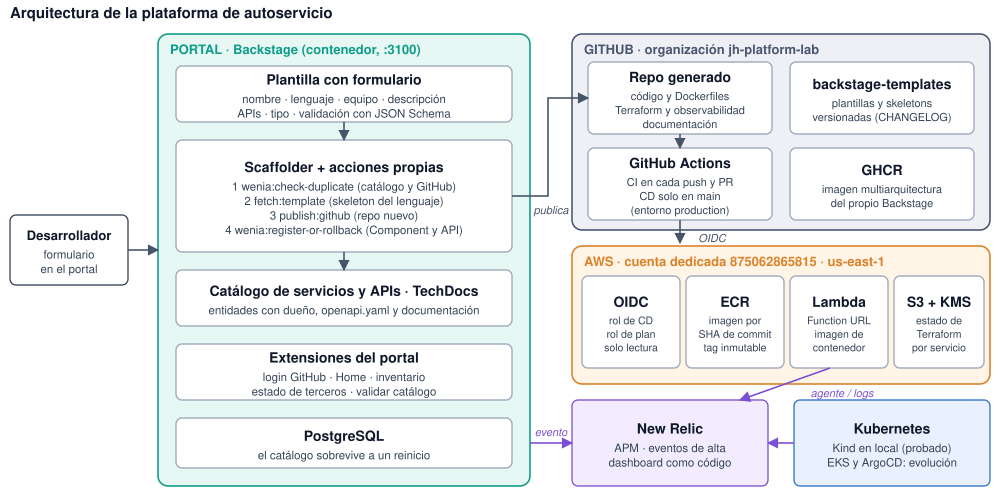
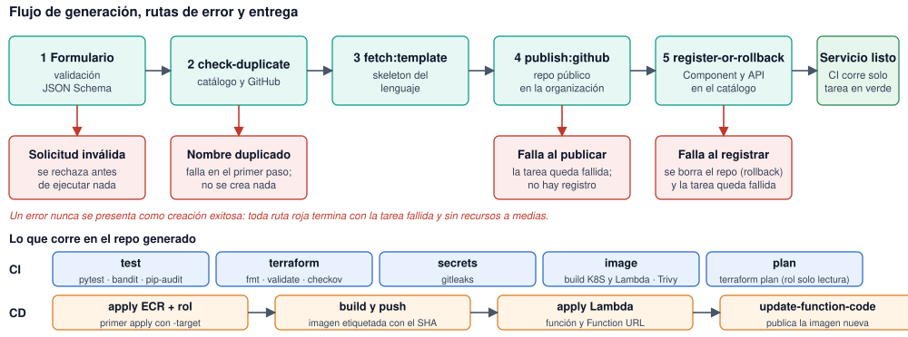

# Plataforma de autoservicio para microservicios

**Caso de estudio Platform Engineer · Wenia** · Repositorios en la organización `jh-platform-lab`: `wenia-platform` (portal Backstage, acciones propias, Ansible, verificación), `backstage-templates` (plantillas) y `onboarding-api` (servicio de ejemplo generado con la plataforma).

## 1. Contexto y alcance

Hoy habilitar un servicio exige solicitudes manuales, copiar configuración entre repositorios y coordinar infraestructura y entrega. El resultado es variación entre servicios, esperas y dependencia del equipo de plataforma. La respuesta es un **camino pavimentado** (*golden path*): una capacidad de autoservicio en Backstage que entrega un servicio listo para empezar a desarrollar, con las decisiones de ingeniería ya resueltas.

El desarrollador llena un formulario (nombre, lenguaje, equipo, descripción, APIs y tipo: AWS Lambda o Kubernetes) y la plataforma crea el repositorio de GitHub, registra el servicio y sus APIs en el catálogo y entrega Dockerfile por caso, CI/CD en GitHub Actions, Terraform, observabilidad con New Relic y documentación operativa. Los lenguajes del caso son **Python y Node.js**; además existen plantillas de Go, Java, S3, SQS y tres de gestión (nueve en total), que se tratan como extras.

**Estado.** El flujo completo funciona en local para Python y Node.js y se verifica con `scripts/verify.sh` (11 comprobaciones en verde). El camino hasta AWS está probado para Python: un servicio creado desde Backstage se despliega como Lambda con Terraform y responde en su Function URL (sección 8).

## 2. Arquitectura

| Componente | Responsabilidad |
|---|---|
| Backstage (contenedor, imagen en GHCR) | Formulario, scaffolder, catálogo, TechDocs y extensiones del portal (Home, inventario, estado de terceros). Login con GitHub y *guest* como respaldo |
| Acciones propias (TypeScript) | `wenia:check-duplicate` y `wenia:register-or-rollback` en `backend/src/modules/wenia-actions/` |
| `backstage-templates` | Una carpeta por plantilla (`template.yaml` + `skeleton/`); el scaffolder muestra una card por plantilla |
| Repositorio generado | Código, `Dockerfile` y `Dockerfile.lambda`, workflows, Terraform, observabilidad, `catalog-info.yaml`, `openapi.yaml` y documentación |
| GitHub Actions | CI en cada push y PR; CD solo en `main` con entorno protegido `production` |
| AWS (cuenta dedicada) | OIDC con dos roles, ECR, Lambda con Function URL y estado de Terraform en S3 con KMS |
| New Relic | Agente APM en Kubernetes, evento por cada alta desde el portal y dashboard como código |

## 3. Flujo de generación y manejo de errores

Un error nunca se presenta como creación exitosa: cada ruta de fallo deja la tarea en rojo y sin recursos a medias.

| Situación | Qué ocurre | Dónde se decide |
|---|---|---|
| Solicitud inválida (p. ej. `Mi_Servicio`) | El formulario la rechaza antes de ejecutar ningún paso | JSON Schema de la plantilla |
| Nombre duplicado | Falla el primer paso; no se crea nada | `wenia:check-duplicate` consulta el catálogo **y** GitHub |
| Falla al publicar el repositorio | La tarea queda fallida; no hay registro | `publish:github` |
| Falla al registrar en el catálogo | Se borra el repositorio recién creado y la tarea queda fallida | `wenia:register-or-rollback` |

## 4. Qué se genera y cómo se entrega

| Pieza | Contenido |
|---|---|
| Aplicación | FastAPI (o Express) con un handler por ruta y su `openapi.yaml`; un handler sin implementar responde **501** a propósito, para que no parezca funcional algo que no lo es |
| Contenedores | `Dockerfile` para Kubernetes y `Dockerfile.lambda`; usuario no root y dependencias fijadas |
| **CI** (valida, no publica) | `test` (pytest, bandit, pip-audit), `terraform` (fmt, validate, checkov), `secrets` (gitleaks), `image` (construye ambas imágenes y Trivy) y `plan` (Terraform plan con un rol de solo lectura) |
| **CD** (publica y despliega) | Solo en `main`: `apply` de ECR y rol (acotado con `-target`), imagen etiquetada con el SHA del commit, `apply` de la Lambda y `update-function-code` |
| Terraform | Módulos locales (`ecr-repo`, `github-cd-role`, `lambda-service`), estado remoto por servicio y credenciales por OIDC, sin llaves de AWS |
| Documentación | README (desarrollar, verificar, operar), tabla de *troubleshooting* y páginas TechDocs visibles en el catálogo |

## 5. Observabilidad

**Del servicio:** agente de New Relic con `newrelic.ini` (APM en Kubernetes; CloudWatch en Lambda), `/health` en cada servicio y alertas y dashboard como código en `observability/newrelic/` (Terraform).

**Del proceso de generación:** cada paso de las acciones propias escribe una línea JSON con un `requestId` que permite seguir una tarea de punta a punta. Además, cada alta emite el evento `WeniaServiceRegistered` (o `WeniaServiceRegistrationFailed`) a New Relic, en modo mejor esfuerzo: si New Relic no responde, el registro no se interrumpe. Un dashboard muestra altas por día, por tipo y por equipo, y fallos con su reversión. Se verificó de punta a punta: un servicio creado desde Backstage dejó una fila en New Relic con el mismo `requestId` del log.

## 6. Decisiones principales

| Decisión | Motivo |
|---|---|
| Validar el formulario antes de ejecutar | Una solicitud inválida no crea nada |
| Duplicados en catálogo **y** GitHub | Con solo el catálogo quedaría un repositorio huérfano sin detectar |
| Rollback dentro de una sola acción | Los pasos del scaffolder no tienen "en caso de fallo" |
| Una carpeta autocontenida por plantilla | Con `file:` el scaffolder solo lee dentro de la carpeta; lo compartido no funciona en local |
| CI separado de CD; CD con entorno `production` | El CI valida sin publicar; solo el CD toca la nube |
| OIDC en lugar de llaves | El rol de CD solo acepta el entorno `production` del repo; el `plan` de los PR usa otro rol de solo lectura |
| Lambda como imagen de contenedor | Misma imagen y mismo escaneo que en Kubernetes; el ECR existe antes que la función |
| Function URL pública | Decisión para la demostración; en producción iría detrás de API Gateway con autorizador y WAF |
| Backstage en contenedor, imagen en GHCR | Reproducible con `docker compose`; el registro es una variable (pasar a ECR es cambiar la variable y el login) |
| Backstage estándar con módulos propios | Se evita bifurcar el portal; lo propio vive en acciones y módulos del frontend |

## 7. Verificación

| Caso | Resultado | Evidencia |
|---|---|---|
| Creación válida (Python, Lambda) | Repo, catálogo y API creados; CI en verde | `evidence/local/01-*` |
| Solicitud inválida | Rechazada por el formulario | `evidence/local/02-*` |
| Nombre duplicado | Falla en el primer paso | `evidence/local/03-*` |
| Falla con rollback | Tarea fallida y repo borrado | `evidence/local/04-*` |
| API de ejemplo (6 endpoints) | 11 pruebas en verde y `curl` de cada ruta | `evidence/local/05-*` |
| Terraform (fmt, validate, checkov) | Sin fallos | `evidence/local/08-verify.txt` |
| Ansible, segunda ejecución | `changed=0` | `evidence/local/06-*` |
| Kubernetes en Kind | 2 réplicas; `/health` responde | `evidence/local/07-*` |
| Servicio Node.js generado | Pruebas, `npm audit` y `/health` correctos | `evidence/local/08-verify.txt` |
| **AWS:** CD crea ECR, rol y Lambda | `onboarding-api`: CD en verde, imagen con el SHA del commit | `evidence/aws/10-*`, `11-*`, `16-*` |
| **AWS:** Function URL | Los 6 endpoints responden (`/health` 200, alta 201, duplicado 409) | `evidence/aws/15-*`, `16-*` |
| New Relic con cuenta real | Agente con datos de throughput y latencia; eventos de alta en el dashboard | `evidence/local/09-*` |

`verify.sh` separa lo ejecutado en local de lo que requiere AWS o una persona. Una validación estática (Terraform `validate` o checkov) **no** se presenta como evidencia de un despliegue.

## 8. Despliegue en AWS y evolución

**Hoy.** Cuenta dedicada y presupuesto de 5 USD; se evita lo que cuesta sin necesidad (ALB, RDS, Secrets Manager). Un *bootstrap* manual crea una vez el estado de Terraform, el proveedor OIDC, la alerta de presupuesto y dos roles (CD y `plan`). Después cada servicio se despliega solo desde su CD. Llegar al primer despliegue exitoso costó varias iteraciones, cada una con una causa distinta que quedó corregida en el código o en la plantilla (versión 1.6.7): el *subject* OIDC inmutable de la organización, los permisos de lectura que Terraform necesita al refrescar, un `apply` sin `-target` que destruía la Lambda al reintentar, una imagen con atestaciones que Lambda rechaza, la política de ECR que permite a Lambda leer la imagen y una carrera en la Function URL (Lambda añade por su cuenta dos permisos con los mismos nombres que pedía Terraform; se corrigió con nombres propios).

**Evolución hacia una operación en AWS.**

| Etapa | Cambio | Beneficio |
|---|---|---|
| 1 | Backstage en EKS (Helm, ArgoCD y repositorio `gitops`), con RDS para el catálogo y TechDocs en S3 | Portal disponible para varios equipos, sin depender de una máquina local |
| 2 | Servicios de tipo Kubernetes desplegados por ArgoCD en EKS | GitOps: el estado deseado vive en Git y se audita |
| 3 | API Gateway con autorizador y WAF delante de las Lambdas; ECR con escaneo y ciclo de vida | Superficie pública controlada |
| 4 | Una cuenta por entorno con roles OIDC por cuenta y SSO con permisos en Backstage | Aislamiento y trazabilidad |
| 5 | Descubrimiento automático del catálogo desde GitHub en lugar de ubicaciones de archivo | Menos mantenimiento manual |

## 9. Qué medir

La pregunta es doble: ¿mejora la experiencia del desarrollador? y ¿baja la dependencia del equipo de plataforma? Cada métrica necesita una **línea base del proceso manual** antes de compararse. Las metas son propuestas iniciales.

| Métrica | Definición y fuente | Meta propuesta | Responde a |
|---|---|---|---|
| Tiempo hasta el primer despliegue | Del envío del formulario al primer CD en verde (tarea de Backstage + GitHub Actions) | Menos de 15 minutos | Experiencia |
| Tasa de éxito del scaffolder y causa de cada fallo | Logs JSON con `requestId` y eventos en New Relic | Más del 95 % | Fiabilidad |
| Duración de la tarea (p50 y p95) | Eventos de las acciones propias | p95 por debajo de 3 minutos | Experiencia |
| Adopción | Servicios nuevos creados por plantilla frente al total | Más del 80 % | Valor del camino |
| Tickets o solicitudes al equipo de plataforma por servicio nuevo | Sistema de tickets; contraste con la línea base | Cercano a cero | **Dependencia** |
| Tiempo de espera hasta tener repositorio y CI | Antes (manual) frente a después | Reducción de horas o días a minutos | **Dependencia** |
| Servicios desactualizados | Servicios por versión de plantilla (`wenia.io/template-version`) | Menos del 10 % a más de dos versiones | Mantenibilidad |
| Rollbacks fallidos | Repos huérfanos tras un fallo | Cero | Fiabilidad |
| CI en verde en el primer push | Resultado del primer run | Más del 90 % | Calidad de la plantilla |
| Costo de AWS por servicio | Etiquetas de costo por servicio | Dentro del presupuesto | Costo |
| Satisfacción del desarrollador | Encuesta corta tras el primer servicio | 4 o más sobre 5 | Experiencia |

## 10. Evolución de las plantillas

Cada servicio guarda en el catálogo la anotación `wenia.io/template-version`, y el `CHANGELOG` registra qué cambió en cada versión. Los cambios compatibles suben el número menor o de parche; los incompatibles solo van en versión mayor, con una guía de migración. **Un servicio ya generado no cambia solo**: por ejemplo, la corrección de la carrera en la Function URL (1.6.7) solo la reciben los servicios nuevos. Por eso el plan tiene tres piezas:

1. **Detectar deriva:** un proceso programado consulta el catálogo por la anotación y lista los servicios por debajo de la versión vigente.
2. **Actualizar por PR:** la plantilla `update-service` abre un pull request en el repositorio del servicio con la diferencia entre versiones, para que el equipo dueño lo revise y lo fusione. Nunca se empuja a `main`.
3. **Proteger la plantilla:** un workflow renderiza y prueba cada plantilla antes de fusionar un cambio, y una política de deprecación define cuántas versiones se soportan.

## 11. Límites de la implementación

- Solo **Python** tiene el CD de AWS probado de punta a punta. Node.js, Go y Java usan todavía el CD anterior; migrarlos es mecánico porque la estructura es la misma.
- El tipo Kubernetes se probó en **Kind**, sin EKS ni ArgoCD. El `apply` del bootstrap es manual.
- Un CD fallido no se relanza sobre el mismo commit (el ECR tiene tags inmutables): se corrige con un commit nuevo.
- New Relic: el agente reporta a una cuenta real y el dashboard de altas está importado; las alertas por servicio están como código pero no se aplicaron con Terraform (requieren una API key de usuario).
- Go, Java, S3, SQS y las plantillas de gestión se validaron por partes (renderizado, pruebas y Terraform), sin prueba completa desde la interfaz.
- La detección de deriva y la actualización automática de servicios están diseñadas, no implementadas.

**Procedencia.** Backstage (distribución estándar, con la configuración de Wenia), mkdocs-material y mkdocs-techdocs-core (TechDocs), Express y serverless-http (Node.js), FastAPI y Mangum (Python), net/http (Go), Spring Boot (Java), imágenes base oficiales (`node:24-slim`, `python:3.12`, `public.ecr.aws/lambda`, `distroless`) y las acciones oficiales de GitHub. No se usó código ni información de empleadores.

**Uso de IA.** El trabajo se hizo con Claude Code bajo dirección y revisión de una persona; cada cambio pasó por un PR fusionado por ella. Cada resultado se verificó con pruebas, `verify.sh`, el CI y ejecuciones reales (Backstage, GitHub y AWS), y los errores de la IA y su corrección quedaron documentados en `docs/uso-ia.md`.
