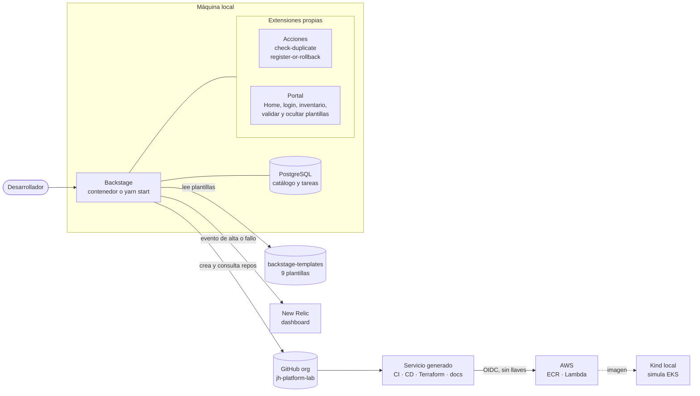
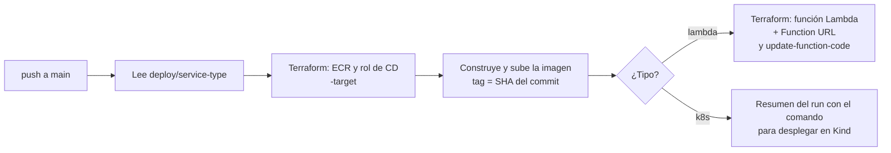
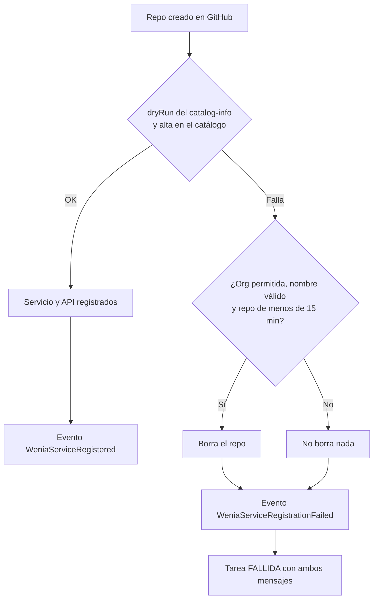

# Guía de implementación local: plataforma de autoservicio sobre Backstage

**Caso:** Platform Engineer, capacidad de autoservicio que genera un microservicio listo para desarrollar.
**Versión del documento:** 2026-11-03 · **Alcance:** cómo está construida la solución y cómo ponerla a funcionar en una máquina local, con AWS como complemento opcional.

---

## 1. Resumen

Un desarrollador completa un formulario en Backstage (nombre, lenguaje, equipo, descripción, APIs y tipo de servicio). La plataforma verifica la solicitud, genera un proyecto consistente, lo publica como repositorio en GitHub y lo registra en el catálogo de servicios y de APIs. El proyecto trae Dockerfile por caso, CI/CD en GitHub Actions, Terraform, observabilidad con New Relic y documentación operativa.

| Requisito del caso | Cómo se cubre | Dónde |
|---|---|---|
| Formulario de autoservicio | Plantilla de Backstage con validación en tres pasos | `backstage-templates/templates/<plantilla>/template.yaml` |
| Repositorio en GitHub con scaffolding por lenguaje | `fetch:template` + `publish:github` sobre el `skeleton/` de cada plantilla | `templates/<plantilla>/skeleton/` |
| Servicio y APIs en el catálogo | `catalog-info.yaml` generado (Component + API OpenAPI) y registrado por la acción propia | `wenia:register-or-rollback` |
| Dockerfile para cada caso | `Dockerfile` (Kubernetes) y `Dockerfile.lambda` (Lambda), siempre generados | skeleton |
| CI/CD en GitHub Actions | `ci.yml` valida sin publicar; `cd.yml` publica y despliega | skeleton |
| Infraestructura como código | Terraform con módulos locales y estado remoto en S3 | skeleton `terraform/` |
| Observabilidad en New Relic | Agente en el servicio, alertas y dashboard como código, evento de alta desde la plataforma | skeleton `observability/`, `newRelicEvent.ts` |
| Documentación operativa | TechDocs por servicio: arquitectura, APIs, desarrollo, operación, troubleshooting | skeleton `docs/` |
| Solicitud inválida, duplicados y fallos | Validación del formulario, `wenia:check-duplicate` y rollback | sección 7 |
| Verificación reproducible | `scripts/verify.sh` y carpeta `evidence/` | sección 8 |
| Evolución de plantillas | Anotación de versión, `CHANGELOG.md` y plantilla de actualización | sección 11 |

---

## 2. Arquitectura

### 2.1 Componentes



### 2.2 Secuencia de una solicitud válida

```mermaid
sequenceDiagram
  actor D as Desarrollador
  participant B as Backstage
  participant G as GitHub
  participant C as Catálogo
  participant N as New Relic

  D->>B: Completa el formulario (3 pasos)
  B->>B: Valida el nombre (DNS, 3 a 40 caracteres)
  B->>C: 1. check-duplicate: ¿existe en el catálogo?
  B->>G: 1. check-duplicate: ¿existe el repo?
  B->>B: 2. fetch:template (skeleton + parámetros)
  B->>G: 3. publish:github (repo nuevo)
  B->>C: 4. dryRun del catalog-info y alta del Component y la API
  B->>N: Evento WeniaServiceRegistered
  B-->>D: Enlaces al repo y al catálogo
  G->>G: CI en cada push; CD solo en main
```

---

## 3. Prerrequisitos

| Herramienta | Para qué | Obligatoria |
|---|---|---|
| Docker Desktop | PostgreSQL y Backstage en contenedor | Sí |
| Node 24 (`nvm`, `.nvmrc`) y Yarn | Modo desarrollo (`yarn start`) | Solo en desarrollo |
| `git` y `gh` | Clonar repos y trabajar con GitHub | Sí |
| Token de GitHub fine-grained, limitado a la organización | Crear repos, consultar duplicados y borrar en el rollback | Sí |
| OAuth App de GitHub | Login con GitHub (invitado queda de respaldo) | No |
| Cuenta de New Relic (licencia y Account ID) | Eventos, dashboard y APM | No |
| AWS CLI, `kind`, `kubectl` | Despliegue en AWS y en Kind | No |

Los tres repos deben quedar **en la misma carpeta**, porque el modo desarrollo lee las plantillas con una ruta relativa (`../backstage-templates`):

```
Repos/
  wenia-platform/        portal, acciones propias, infra base, scripts, evidencia
  backstage-templates/   nueve plantillas
  onboarding-api/        servicio de ejemplo (6 endpoints)
```

---

## 4. Puesta en marcha

### 4.1 Variables de entorno

```bash
cd wenia-platform
cp .env.local.example .env.local      # .env.local no se sube a git
```

| Variable | Para qué | Obligatoria |
|---|---|---|
| `POSTGRES_USER`, `POSTGRES_PASSWORD`, `POSTGRES_PORT` | Base de datos del catálogo | Sí |
| `BACKSTAGE_WEB_PORT`, `BACKSTAGE_BACKEND_PORT` | Puertos propios (web 3100, backend 7100) | Sí |
| `GITHUB_TOKEN` | Integración con GitHub (crear, consultar y borrar repos) | Sí |
| `AUTH_GITHUB_CLIENT_ID`, `AUTH_GITHUB_CLIENT_SECRET` | Login con GitHub (20 y 40 caracteres) | No |
| `NEW_RELIC_LICENSE_KEY`, `NEW_RELIC_ACCOUNT_ID`, `NEW_RELIC_REGION` | Evento de alta a New Relic (`us` por defecto) | No |

Verifica el entorno antes de levantar nada: `bash scripts/check-env.sh`. Comprueba cuenta de AWS y de GitHub, y detecta credenciales de relleno o variables vacías sin imprimir valores.

### 4.2 Dos formas de ejecutar

| Forma | Comandos | Cuándo |
|---|---|---|
| **Todo en contenedores** | `docker compose --profile app up -d` | Demostración; simula el despliegue en Kubernetes |
| **Desarrollo** | `docker compose up -d postgres`, luego `cd backstage && yarn install && yarn start` | Cambiar código; recarga en segundos |
| **Autodespliegue (opcional)** | `docker compose --profile app --profile autodeploy up -d` | Watchtower recrea el contenedor cuando el CI publica una imagen nueva |

Abre `http://localhost:3100`. Si el contenedor no tiene credenciales válidas de GitHub, se **niega a arrancar** con un mensaje claro (guard del `docker-compose.yml`).

> **Cuidado con las variables.** Al recrear el contenedor, las variables se leen del `.env.local` de la carpeta desde donde se ejecuta `docker compose`. Watchtower recrea con la configuración anterior y no las refresca. Para confirmar que una variable llegó: `docker exec wenia-backstage sh -c 'echo ${#NEW_RELIC_ACCOUNT_ID}'` debe imprimir su longitud (7), no 0.

### 4.3 Login con GitHub

1. Crea una OAuth App en GitHub. La URL de callback apunta al backend: `http://localhost:3100/api/auth/github/handler/frame` para el contenedor.
2. Guarda el client ID y el secret en `.env.local`.
3. El login de GitHub debe coincidir con un `User` del catálogo (`catalog/org.yaml`); el resolver es `usernameMatchingUserEntityName`.
4. **Invitado** queda disponible como respaldo y es lo que se usa en modo desarrollo en otros puertos.

### 4.4 Ver los cambios

| Qué cambias | Con `yarn start` | Con el contenedor |
|---|---|---|
| Código de Backstage (Home, acciones, config) | Se ve en segundos | Reconstruir la imagen (CI al hacer merge a `main`) |
| Una plantilla o skeleton | Al instante: lee tu carpeta local | Solo cuando está en `main`: lee de GitHub |
| `catalog/org.yaml` | En unos segundos | Solo cuando está en `main` |

---

## 5. Qué se implementó y cómo

### 5.1 Portal de Backstage (`wenia-platform/backstage/packages/app/src/modules/`)

| Módulo | Función |
|---|---|
| `auth` | Pantalla de entrada propia con GitHub e invitado |
| `theme` | Tema oscuro único (reemplaza al claro por defecto) |
| `nav` | Menú reducido en dos grupos: Plataforma y El reto |
| `home` | Home con accesos rápidos, flujo, métricas vivas del catálogo, estado de plataforma y observabilidad. El orden de los widgets sale de `page:home defaultConfig` en `app-config.yaml` |
| `catalog-tools` | Botón **Validar catálogo** (comprueba en GitHub que cada repo existe y limpia huérfanos) y botón **Ocultar plantillas** (filtro por usuario, reversible, sin borrar nada) |
| `inventory` | `/inventory`: altas recientes, CI por repo, última imagen publicada por el CD, servicios y APIs |
| Estado de terceros | Tarjetas de GitHub, AWS (us-east-1) y New Relic, consultadas por proxy cada minuto |

**Seguridad del proxy.** `app-config.yaml` define `proxy.endpoints` solo con `GET`. El token de GitHub viaja en el servidor y nunca llega al navegador, y cada llamada exige una sesión (se eliminó una opción que lo exponía sin login).

### 5.2 Acciones propias del scaffolder (`backstage/packages/backend/src/modules/wenia-actions/`)

| Archivo | Responsabilidad |
|---|---|
| `checkDuplicate.ts` | `wenia:check-duplicate`: consulta el catálogo **y** GitHub; falla en el primer paso si el nombre existe |
| `registerOrRollback.ts` | `wenia:register-or-rollback`: valida el `catalog-info.yaml` con un `dryRun`, registra el Component y la API y, si falla, borra el repo de esa tarea |
| `newRelicEvent.ts` | Envía el evento a New Relic: mejor esfuerzo, 5 s de espera, no lanza errores y no registra la clave |
| `structuredLog.ts` | Logs JSON con `requestId` (el id de la tarea) para seguir el proceso de generación |

Los pasos del scaffolder no tienen "en caso de fallo", así que la compensación vive dentro de la acción que puede fallar.

### 5.3 Plantillas (`backstage-templates/templates/`)

| Plantilla | Crea |
|---|---|
| `python-service` | Servicio FastAPI |
| `nodejs-service` | Servicio Express |
| `go-service` | Servicio net/http (imagen distroless) |
| `java-service` | Servicio Spring Boot 3 (Java 21) |
| `s3-bucket` | Bucket S3 con KMS, versionado y TLS (Terraform) |
| `sqs-queue` | Cola SQS con DLQ, KMS y TLS (Terraform) |
| `update-service` | PR que actualiza los archivos de plataforma de un servicio |
| `add-observability` | PR que añade alertas y dashboard de New Relic |
| `team-registration` | PR que registra un equipo en el catálogo |

**Anatomía de una plantilla de servicio**

1. `parameters`: tres pasos (datos del servicio, APIs, revisión). El nombre se valida con la expresión regular `^[a-z][a-z0-9-]{1,38}[a-z0-9]$` y el equipo sale de una lista cerrada.
2. `steps`: `check-duplicate` → `fetch:template` (skeleton) → `publish:github` (la organización está fija) → `register` (con rollback).
3. `skeleton/`: lo que recibe el servicio generado. Los workflows y los lockfiles se copian con `copyWithoutTemplating`, porque la sintaxis `${{ }}` de GitHub Actions choca con Nunjucks.

**Contenido del skeleton:** código con las rutas del formulario como stubs (`501` hasta implementarlas), `openapi.yaml`, `Dockerfile` y `Dockerfile.lambda`, `.github/workflows/`, `terraform/`, `k8s/`, `observability/newrelic/`, `docs/` (TechDocs) y `catalog-info.yaml`.

### 5.4 Servicio generado: CI y CD

**CI (`ci.yml`, en cada PR y en `main`; nunca publica ni toca la nube)**

| Job | Qué valida |
|---|---|
| `test` | Pruebas unitarias y auditoría de dependencias (`bandit` y `pip-audit` en Python; `npm test` y `npm audit` en Node) |
| `secrets` | Gitleaks sobre el historial |
| `terraform` | `fmt`, `init -backend=false`, `validate` y `checkov` |
| `image` | Construye las dos imágenes y analiza la de Kubernetes con Trivy (HIGH y CRITICAL con arreglo) |
| `terraform-plan`, `workflows`, `docs`, `kind` | Plan de solo lectura en PR, `actionlint`, build estricto de TechDocs y despliegue de los manifiestos en Kind dentro del runner (hoy en Python) |

**CD (`cd.yml`, solo al fusionar en `main`, entorno `production`, autenticación OIDC sin llaves)**



El estado de Terraform es **por servicio** (`<servicio>/terraform.tfstate` en un bucket S3 con bloqueo por archivo), lo que hace al CD idempotente: un reintento no duplica ni destruye recursos.

### 5.5 Observabilidad

| Capa | Qué hay | Estado |
|---|---|---|
| Proceso de generación | Logs JSON con `requestId` y consulta de tareas (`/api/scaffolder/v2/tasks`) | Verificado |
| Plataforma → New Relic | `WeniaServiceRegistered` y `WeniaServiceRegistrationFailed` en cada alta o fallo | Verificado con cuenta real |
| Dashboard | `observability/newrelic/wenia-registrations-dashboard.json` (7 consultas NRQL). Se importa en **Dashboards → Import** cambiando `accountIds` por el ID de la cuenta | Verificado |
| Servicio como aplicación (APM) | Agente configurado (`newrelic.ini` o `newrelic.js`); necesita `NEW_RELIC_LICENSE_KEY` en ejecución | Verificado con datos reales; sin licencia el agente se desactiva y el servicio arranca igual |
| Alertas por servicio | Terraform en `observability/newrelic/`; el CI lo valida, el CD no lo aplica | Validación estática |

### 5.6 Catálogo y documentación

- `catalog/platform.yaml`: el sistema `wenia-platform`, sus componentes y recursos (Catalog Graph).
- `catalog/org.yaml` y `catalog/teams/`: usuarios y equipos. La plantilla `team-registration` añade un archivo por equipo.
- `docs-site/`: TechDocs de la propia plataforma (usar, arquitectura, operación).
- Cada servicio publica sus propios TechDocs y una página de APIs que parte de su `openapi.yaml`.

### 5.7 Ansible

`ansible/prepare-env.yml` prepara los archivos locales de forma **idempotente**: la primera ejecución cambia cosas y la segunda termina con `changed=0`. Ejecución: `bash scripts/ansible-demo.sh`.

---

## 6. Crear un servicio, de principio a fin

1. Abre `http://localhost:3100/create` y elige la plantilla (Python o Node.js).
2. **Paso 1, datos:** nombre, descripción, equipo y **tipo de servicio** (Lambda o Kubernetes).
3. **Paso 2, APIs:** una operación por método (nombre, método HTTP y ruta). Cada una genera una ruta y su entrada en `openapi.yaml`.
4. **Paso 3, revisión:** confirma y pulsa **Create**.
5. Sigue la tarea. Al terminar aparecen **Repositorio** y **Abrir en el catálogo**.
6. En GitHub (**Actions**) corren el CI y el CD. Al terminar:
   - **Lambda:** `curl <Function URL>/health` responde 200 (`/items` devuelve 501 hasta implementarla).
   - **Kubernetes:** el resumen del CD trae el comando; `bash scripts/kind-deploy.sh --ecr` baja la imagen de ECR y la despliega en el clúster Kind `wenia-eks`.

**Tipo de servicio = dónde corre.** El código, el catálogo, las APIs, el CI y la documentación son iguales en los dos tipos. Cambia solo el destino y el último paso del CD.

---

## 7. Solicitudes inválidas, duplicados y fallos

| Caso | Qué ocurre | Evidencia |
|---|---|---|
| Solicitud válida | Repo creado, servicio y API en el catálogo, enlaces devueltos | `evidence/local/01-*` |
| Solicitud inválida (`Mi_Servicio`) | El formulario la rechaza; no corre ningún paso | `evidence/local/02-*` |
| Nombre duplicado (`onboarding-api`) | `check-duplicate` falla en el primer paso; no se crea nada | `evidence/local/03-*` |
| Fallo durante la generación | El registro falla tras crear el repo; se borra el repo y la tarea queda **fallida**, nunca exitosa | `evidence/local/04-*` |



**Guardas contra borrar el repo equivocado:** solo la organización permitida, el nombre pasa por la expresión regular y solo se borra un repo creado hace menos de 15 minutos. Si falla el propio rollback, la tarea falla con los dos mensajes para que se vea si queda algo por limpiar a mano.

### 7.1 Forzar un fallo para demostrarlo (sin ganchos de prueba en producción)

1. En `backstage-templates/templates/python-service/template.yaml`, **línea 150**, cambia `catalogInfoPath: /catalog-info.yaml` por `catalogInfoPath: /no-existe.yaml`.
2. Crea un archivo `dev-3101.yaml` (por ejemplo en `/tmp`) para usar puertos distintos a los del contenedor, que ocupa el 3100:
   ```yaml
   app:
     baseUrl: http://localhost:3101
   backend:
     baseUrl: http://localhost:7101
     listen:
       port: 7101
     cors:
       origin: http://localhost:3101
     database:
       client: better-sqlite3
       connection: ':memory:'
   ```
   Y arranca en modo desarrollo:
   ```bash
   cd wenia-platform/backstage
   yarn start --config app-config.yaml --config /tmp/dev-3101.yaml
   ```
3. En `http://localhost:3101`, entra como invitado y crea un servicio con un nombre nuevo.
4. Resultado esperado: el paso de registro en rojo y `Rollback of jh-platform-lab/<nombre>: repository deleted`. Comprueba que `gh api repos/jh-platform-lab/<nombre>` responde 404.
5. Revierte: `git checkout -- templates/python-service/template.yaml`.

El contenedor lee las plantillas de GitHub; por eso este ejercicio se hace en modo desarrollo, que lee la carpeta local.

---

## 8. Verificación

```bash
bash scripts/verify.sh --kind     # unos 10 minutos; todo corre en contenedores
```

Ejecuta: pruebas de `onboarding-api`, renderizado de la plantilla en Python y Node.js con sus pruebas, Terraform (`fmt`, `validate`, `checkov`), construcción de las imágenes, Ansible dos veces y despliegue en Kind. Lo que requiere AWS o una persona se lista aparte, sin presentarlo como ejecutado.

| Ámbito | Comprobación | Estado |
|---|---|---|
| Local | Ansible con segunda ejecución `changed=0`; pruebas y `bandit`; renderizado Python y Node; Terraform `fmt`, `validate` y `checkov`; imágenes; Kind con `curl /health` | Automatizado (`verify.sh`) |
| AWS | `apply` de ECR, OIDC y Lambda; CD que publica y actualiza la Lambda; Function URL desde internet | Evidencia en `evidence/aws/` |
| Manual | Los cuatro casos del scaffolder; New Relic con cuenta real | Capturas en `evidence/local/` |

**Regla del documento:** la validación estática de Terraform no se presenta como un despliegue exitoso. Lo desplegado en AWS tiene su propia carpeta de evidencia.

---

## 9. AWS (opcional)

| Tema | Detalle |
|---|---|
| Cuenta | Una cuenta propia del reto. Nunca la cuenta de gestión de la organización |
| Bootstrap (una sola vez) | `infra/bootstrap`: bucket de estado con KMS, proveedor OIDC de GitHub, roles y un presupuesto de 5 USD. Lo aplica una persona con `terraform apply` |
| Autenticación del CD | OIDC: sin llaves en GitHub. La confianza del rol acepta el formato del subject de la organización y el entorno `production` |
| Costos | Lambda y ECR dentro del nivel gratuito; el costo fijo es la llave KMS del estado (~1 USD al mes) |
| Limpieza | Destruir con `terraform destroy` los recursos de cada demo (ECR, rol de CD, Lambda); borrar el estado del servicio en S3 si se reutiliza el nombre |
| Kubernetes | Sin clúster EKS (por costo y tiempo). El CD publica la imagen en ECR y `kind-deploy.sh --ecr` la despliega en Kind. El despliegue a EKS queda como evolución |

---

## 10. Troubleshooting (problemas reales encontrados)

| Síntoma | Causa | Qué hacer |
|---|---|---|
| El login con GitHub da 404 | Credenciales de relleno en `.env.local` (`pendiente`) | Pon el client ID (20) y el secret (40) reales. El contenedor ya se niega a arrancar con relleno |
| Los eventos de New Relic salen `skipped` | `NEW_RELIC_ACCOUNT_ID` vacío dentro del contenedor | Completa `.env.local` y **recrea** el contenedor; verifica con `docker exec` |
| El CD falla con `AssumeRoleWithWebIdentity` | La organización usa subject OIDC inmutable | La confianza del rol acepta ambos formatos |
| El CD falla con `repository ... does not exist` | El CD subía la imagen antes de crear el ECR | Primer `terraform apply` con `-target=module.ecr -target=module.cd_role` |
| Lambda: `409 ResourceConflictException` en el primer `apply` | Lambda crea permisos con nombres que Terraform también pedía | Identificadores propios para los permisos de la Function URL |
| Lambda rechaza la imagen (`media type is not supported`) | Atestaciones de buildx | `--provenance=false --sbom=false` |
| CI falla en Trivy (undici, brace-expansion) | El npm de la imagen base trae CVE | Eliminar npm y npx de la imagen final |
| El Home muestra "No widgets" o un diseño viejo | Un layout guardado en el navegador pisa el predeterminado | Edit → Restore defaults → Save |
| `docker compose` no conecta | Docker Desktop apagado | Abrirlo; los contenedores tienen `restart: unless-stopped` |
| Choque de puertos | Otro Backstage en 3000/7007 | Usar los puertos propios (3100, 7100, 5442) o la config de 3101 |

---

## 11. Seguridad, límites y evolución

**Decisiones de seguridad**
- El token de GitHub es fine-grained, limitado a la organización y de corta vida; vive en `.env.local`, que git ignora.
- El proxy de Backstage es solo lectura y exige sesión. El navegador nunca ve el token.
- El CD usa OIDC y el entorno `production`; el CI nunca toca la nube.
- El rollback tiene tres guardas y el borrado exige un permiso de administración (en producción sería una GitHub App con permisos acotados).

**Límites actuales**
- Kubernetes llega hasta la imagen en ECR y el despliegue en Kind; no hay clúster EKS.
- El CI de Node.js aún no iguala al de Python (le faltan `terraform-plan`, `actionlint`, TechDocs y Kind).
- Go y Java aún no tienen el CD con Terraform y ECR de Python y Node.
- Las plantillas S3 y SQS están validadas estáticamente; falta probarlas en AWS.
- La API no se registra por separado en New Relic: vive en el catálogo y en `openapi.yaml`.
- Los servicios ya generados no cambian solos cuando cambia la plantilla.

**Evolución de las plantillas**
- Cada servicio guarda la anotación `wenia.io/template-version` en su `catalog-info.yaml`. Los cambios compatibles suben la versión menor y se adoptan con la plantilla **Actualizar servicio**, que abre un PR con el diff. Los incompatibles suben la versión mayor y se avisa a los equipos.
- El `CHANGELOG.md` de `backstage-templates` registra cada versión.

**Qué medir para saber si la capacidad funciona**
- Tiempo desde la solicitud hasta el primer despliegue (objetivo: minutos, no días).
- Porcentaje de servicios creados sin intervención del equipo de plataforma.
- Servicios en la última versión de la plantilla frente a los atrasados.
- Solicitudes fallidas y su causa (el dashboard de New Relic ya las cuenta).

---

## Apéndice A. Mapa de repositorios

| Repo | Contenido |
|---|---|
| `wenia-platform` | Backstage (`backstage/`), acciones propias, Ansible, `scripts/`, `infra/`, `observability/`, `catalog/`, `docs-site/`, `evidence/` |
| `backstage-templates` | `templates/<plantilla>/template.yaml` y `skeleton/`, más `CHANGELOG.md` |
| `onboarding-api` | Servicio de ejemplo con 6 endpoints y 11 pruebas |

## Apéndice B. Comandos de referencia

```bash
bash scripts/check-env.sh                          # entorno y credenciales (sin imprimir valores)
docker compose --profile app up -d                 # Backstage y PostgreSQL en contenedores
docker compose up -d postgres && (cd backstage && yarn start)   # modo desarrollo
bash scripts/verify.sh --kind                      # verificación completa
bash scripts/ansible-demo.sh                       # Ansible: segunda ejecución con changed=0
bash scripts/kind-deploy.sh --ecr                  # (en un servicio generado) despliega en Kind desde ECR
```
