# Presentación: plataforma de autoservicio sobre Backstage

Versión en texto de la presentación (`index.html`). Cada sección es una diapositiva. Las imágenes salen de `evidence/`.

---

## 1. Un camino dorado para crear servicios

Autoservicio en Backstage: del formulario a un servicio listo, consistente y verificable.

| El problema | La solución |
|---|---|
| Habilitar un servicio toma días y pasa por solicitudes manuales | Un formulario valida y genera todo |
| Se copian configuraciones entre repos | Repo, catálogo, APIs, Docker, CI/CD, Terraform y documentación |
| Cada equipo lo hace distinto | Los errores se manejan y se pueden verificar |

---

## 2. Cómo encaja

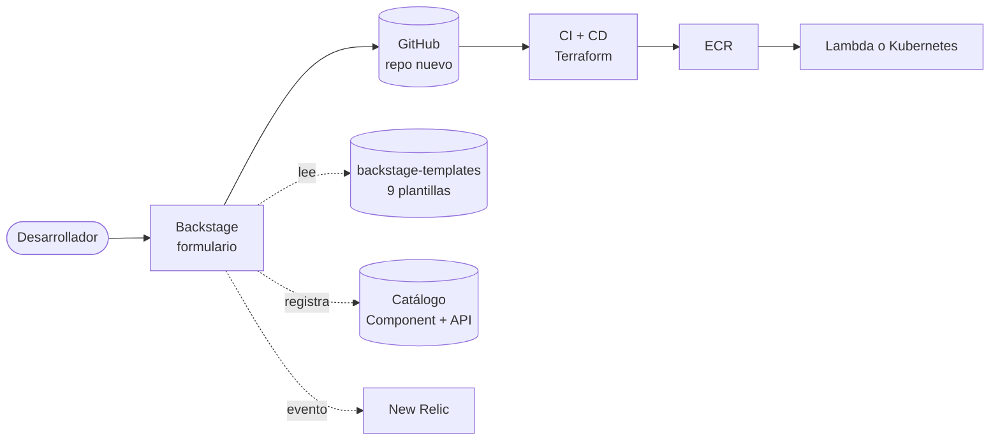

- **Plantillas aparte:** viven en su propio repo para evolucionar sin tocar el portal.
- **Catálogo:** cada servicio queda registrado con su API OpenAPI y su documentación.
- **Observabilidad:** cada alta o fallo envía un evento a New Relic.

---

## 3. Qué hace Backstage al crear: cuatro pasos, con rollback

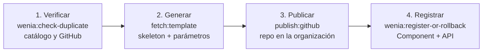

| El formulario valida | El proyecto generado trae |
|---|---|
| Nombre DNS, 3 a 40 caracteres | Dockerfile por caso |
| Equipo de una lista cerrada | CI y CD en GitHub Actions |
| Lenguaje y tipo (Lambda o Kubernetes) | Terraform, k8s y New Relic |
| APIs: nombre, método y ruta | TechDocs y OpenAPI |

---

## 4. Caso válido: servicio creado, repo y catálogo

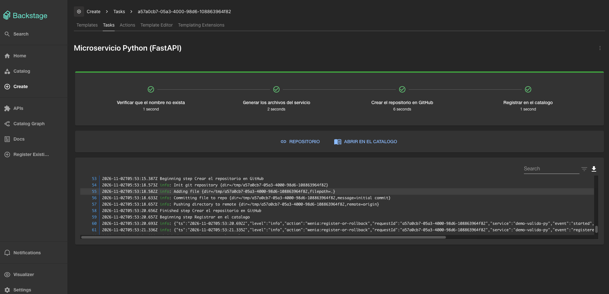
*Tarea con los cuatro pasos en verde.*

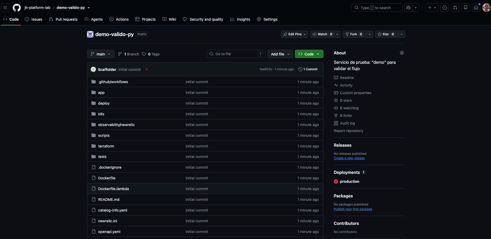
*El repo y la entidad registrada en el catálogo.*

---

## 5. Solicitudes inválidas y duplicadas: un error nunca se presenta como éxito

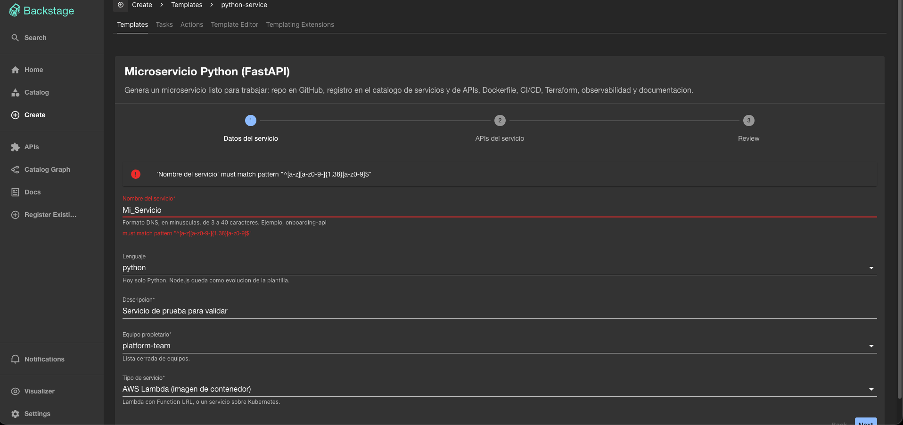
*Inválido: `Mi_Servicio` lo rechaza el formulario y no corre ningún paso.*

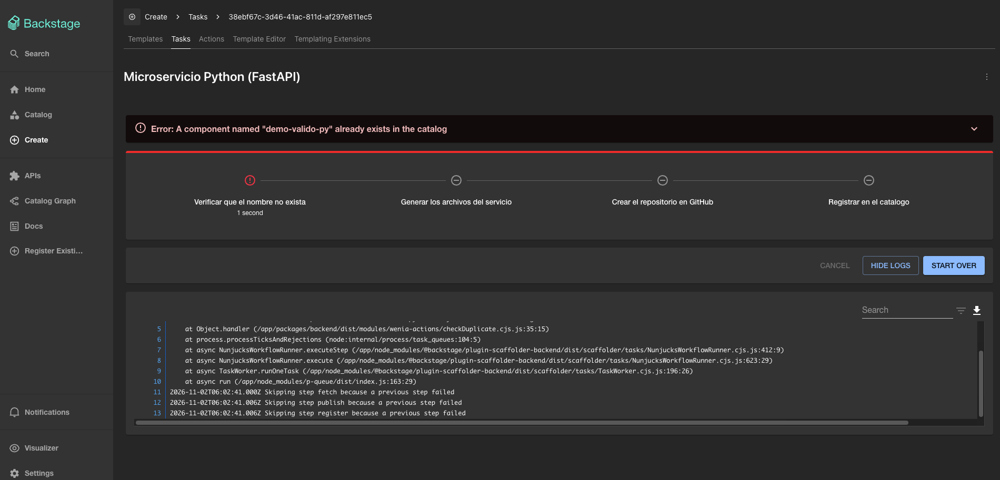
*Duplicado: falla en el primer paso; no se crea nada.*

---

## 6. Fallo durante la generación: rollback dentro de la acción

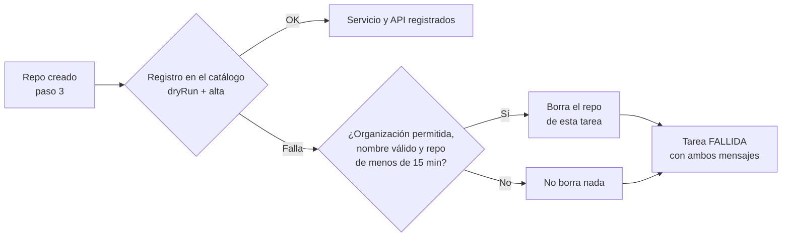

- **Tres guardas:** solo la organización permitida, el nombre pasa por la expresión regular y solo se borran repos creados hace menos de 15 minutos.
- **Por qué dentro de la acción:** los pasos del scaffolder no tienen "en caso de fallo". Si uno falla, los siguientes no corren; la compensación vive donde puede fallar.

---

## 7. Evidencia del rollback (verificado el 1 de noviembre)

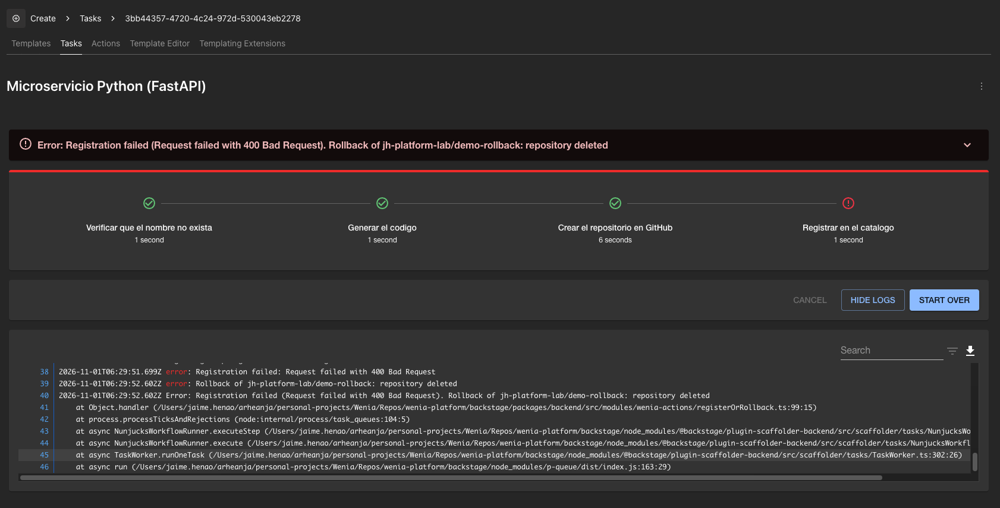
*Pasos 1 a 3 en verde, registro en rojo y `repository deleted`.*

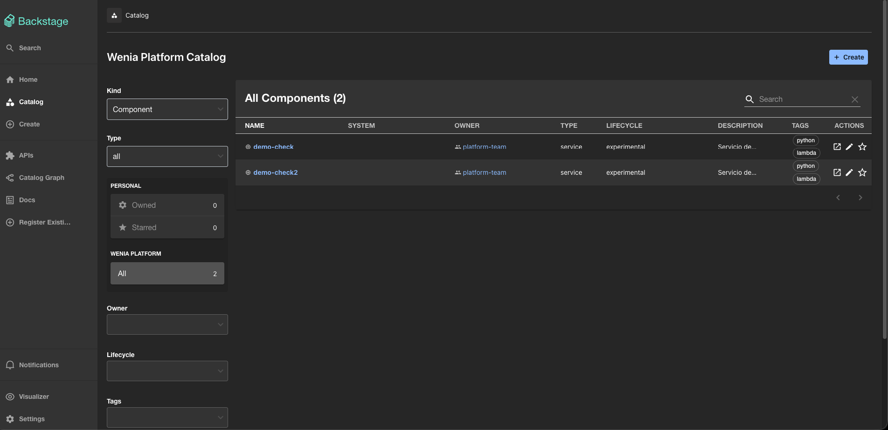
*El catálogo no contiene el servicio fallido.*

---

## 8. Re-verificado el 3 de noviembre, con el evento a New Relic

```
registration-failed   reason: "Request failed with 400 Bad Request"
rollback              repository: jh-platform-lab/demo-rollback2
                      outcome: "repository deleted"
newrelic-event        WeniaServiceRegistrationFailed  outcome: "sent"

Error: Registration failed (Request failed with 400 Bad Request).
       Rollback of jh-platform-lab/demo-rollback2: repository deleted
```

- **Comprobado por fuera:** GitHub responde 404 para el repo, el catálogo tiene 0 componentes con ese nombre y el evento de fallo llegó a New Relic.
- **Cómo se fuerza sin tocar producción:** se cambia `catalogInfoPath` a un archivo que no existe en la plantilla y se crea un servicio en modo desarrollo. Luego se revierte (ver `docs/guia-implementacion-local.md`, sección 7.1).

---

## 9. El repo generado: el CI valida, solo el CD toca la nube

| CI: cada PR y `main`, nunca publica | CD: solo `main`, entorno `production` |
|---|---|
| Pruebas unitarias y auditoría de dependencias | Autenticación OIDC, sin llaves |
| Gitleaks (secretos) | Terraform crea ECR y el rol de CD |
| Terraform: fmt, validate y checkov | Imagen con el SHA del commit como tag |
| Construcción de imágenes y análisis con Trivy | Lambda con Function URL, o Kubernetes en Kind |

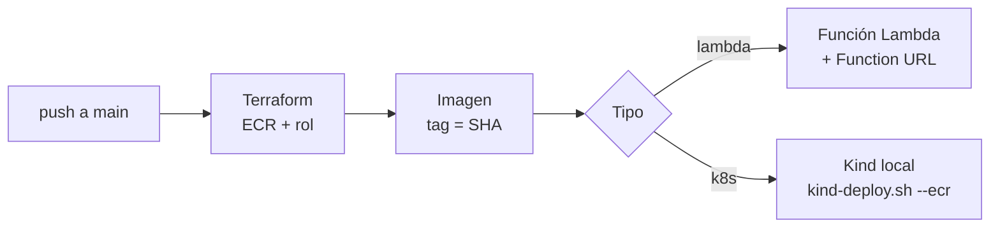

---

## 10. AWS: lo que sí se desplegó

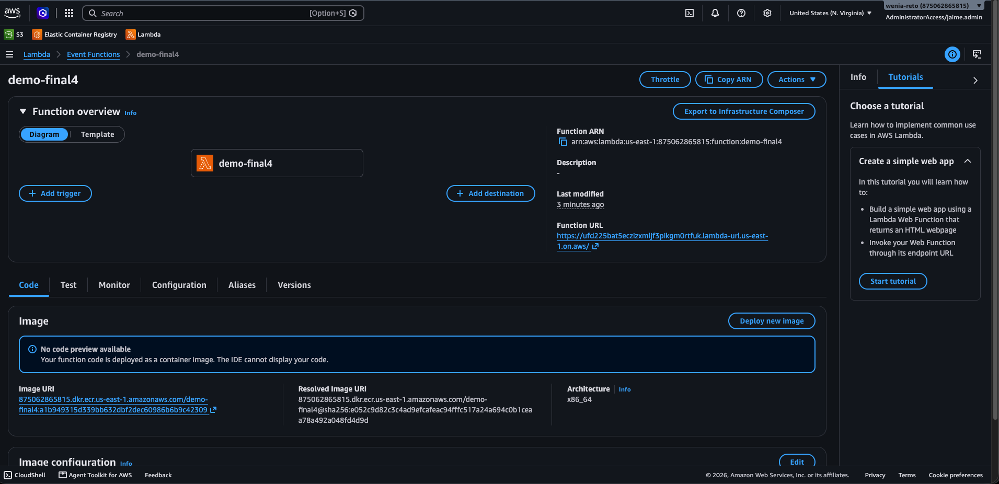
*Función Lambda (paquete de imagen) creada por el CD.*

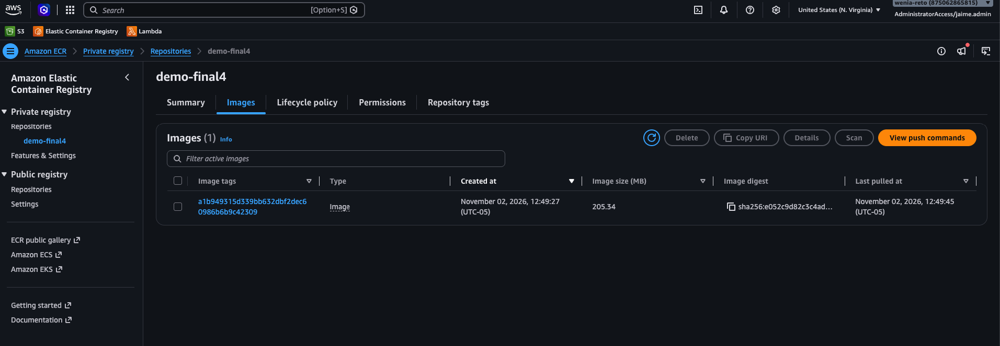
*Imagen en ECR; el tag es el SHA del commit.*

```
$ curl https://<function-url>/health   {"status":"ok"}                -> HTTP 200
$ curl https://<function-url>/items    {"detail":"Not implemented"}   -> HTTP 501  (stub por diseño)
```

---

## 11. Observabilidad: cada alta y cada fallo llegan a New Relic

| Qué | Cómo |
|---|---|
| Alta de servicio | `WeniaServiceRegistered` |
| Fallo de registro | `WeniaServiceRegistrationFailed` |
| Dashboard | Como código (7 consultas NRQL) |
| Servicio (APM) | Agente; activo al correr con la licencia |

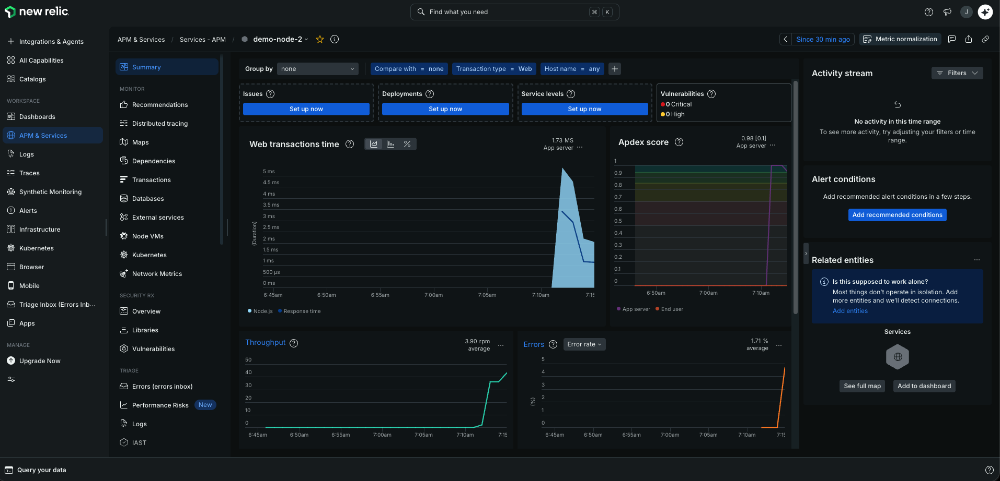
*APM de un servicio generado con datos reales.*

El envío es de mejor esfuerzo: registrar el servicio es lo crítico y la observabilidad no puede tumbar un alta.

---

## 12. Verificación, límites y evolución

| Ámbito | Qué |
|---|---|
| **Local** | Ansible con segunda ejecución `changed=0`; pruebas y bandit; renderizado Python y Node; Terraform fmt, validate y checkov; imágenes; Kind con `/health` |
| **AWS** | Terraform apply, CD a ECR y Lambda, Function URL (`evidence/aws/`) |
| **Manual** | Los cuatro casos del scaffolder y New Relic con cuenta real |

**Límites, sin adornos**
- Kubernetes llega a la imagen y a Kind; no hay EKS.
- Go y Java: CD completo pendiente.
- S3 y SQS: validación estática, sin probar en AWS.

**Evolución**
- Anotación de versión en cada servicio.
- La plantilla "Actualizar servicio" abre un PR con el diff.
- Qué medir: tiempo hasta el primer despliegue y solicitudes fallidas.

Todo se verifica con un comando: `bash scripts/verify.sh --kind`.
